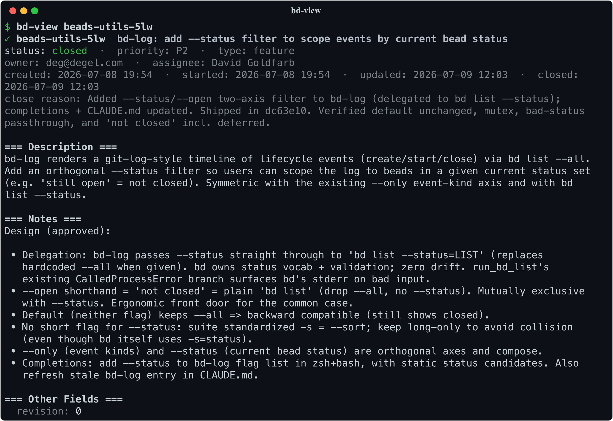
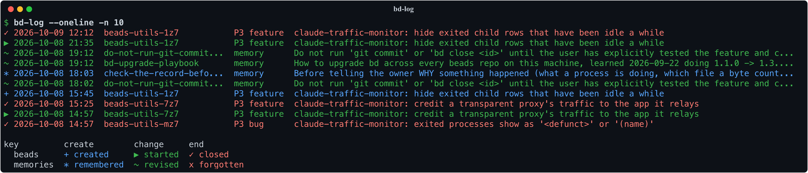
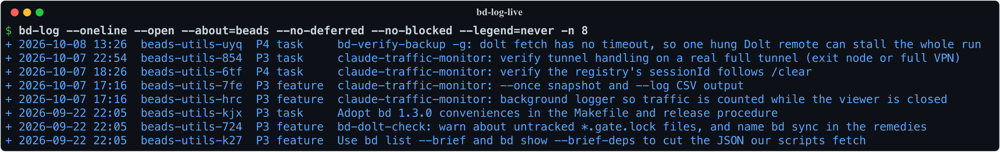
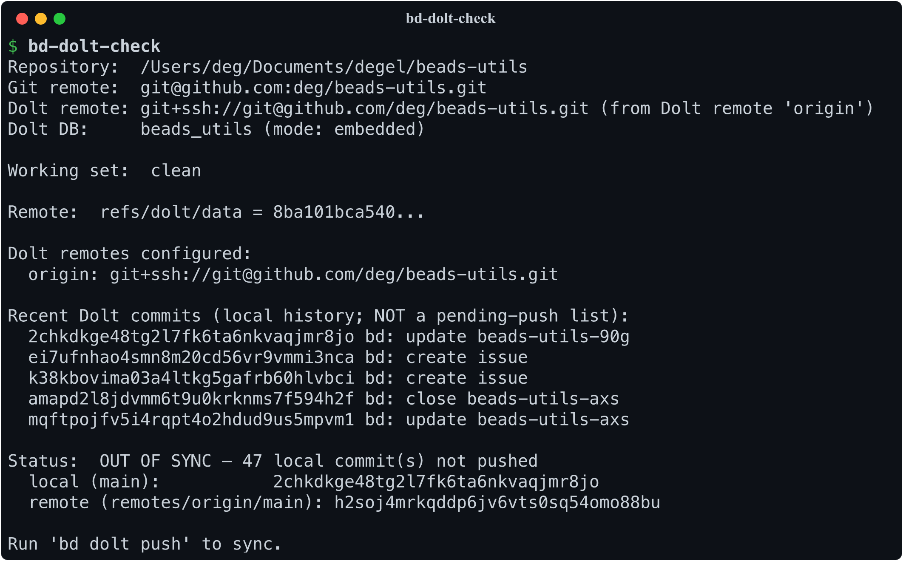
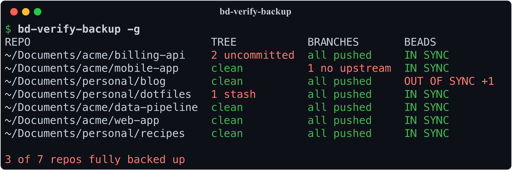
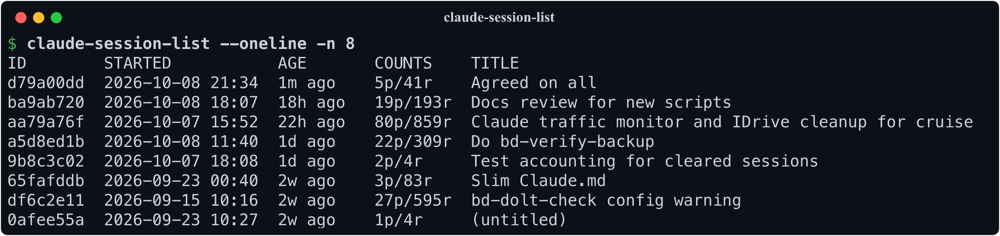
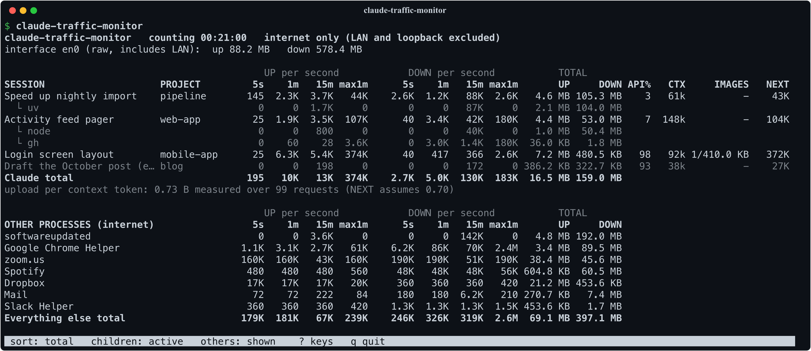

# beads-utils

[](https://github.com/deg/beads-utils/actions/workflows/lint.yml)

A small collection of Python CLI scripts that augment
[`bd`](https://github.com/gastownhall/beads) (the beads issue
tracker) and its Dolt-backed storage. No package, no build step —
each script lives at the repo root alongside a shared `bdutils.py`
helper and runs with `python3` (or `uv` for the one script that
needs `rich`).

## Install

Clone it, then link the scripts onto your `PATH`:

```bash
git clone https://github.com/deg/beads-utils && cd beads-utils
make install                      # symlinks into ~/.local/bin
make install PREFIX=~/bin         # ...or wherever you keep them
```

The symlinks point back at the clone, so the scripts still run from it — edit
one and the change takes effect immediately, with no reinstall. Keep the clone
around; `make uninstall` removes the links again.

Two things `make install` deliberately doesn't do: it won't put `PREFIX` on
your `PATH` (it says so if it isn't), and it won't set up tab completion —
run `make completions` for that line. Or skip installing entirely and just put
the clone itself on `PATH`; the scripts run in place either way.

`make install-claude` is separate: it links the Claude Code hooks under
`hooks/` into `~/.claude/hooks` (or `CLAUDE_HOME=...`), for the pieces that
plug into Claude Code itself rather than run from a shell. See
[Keeping Claude Code memories](#keeping-claude-code-memories).

## Scripts

| Script | What it does |
|---|---|
| [`bd-export-csv`](bd-export-csv) | Export the bead database to a flat CSV for spreadsheet review |
| [`bd-dolt-check`](bd-dolt-check) | Verify the Dolt data behind a `bd` repo is actually committed and pushed to its git remote |
| [`bd-verify-backup`](bd-verify-backup) | Check a repo is fully backed up — nothing uncommitted, every branch pushed, beads pushed; `-g` checks every beads repo on the machine |
| [`bd-dolt-diff`](bd-dolt-diff) | Preview what a `bd dolt push` would send: issue-level diff between local and remote Dolt state |
| [`bd-log`](bd-log) | Git-log-style timeline of bead *and* memory lifecycle events — created, changed, ended (color-coded, auto-paged) |
| [`bd-find-live`](bd-find-live) | List the beads that are live work — open or in progress, minus those parked behind a deferred bead — as JSON |
| [`claude-session-find`](claude-session-find) | Substring search across `~/.claude/projects/*.jsonl` to find old Claude Code sessions |
| [`claude-session-list`](claude-session-list) | Git-log-style listing of Claude Code sessions (default: current project; `-g` for all) |
| [`claude-session-rename`](claude-session-rename) | Set a Claude Code session's title from the shell, like `/rename`, without starting the session |
| [`bd-view`](bd-view) | Pretty-print a single bead with rendered Markdown |
| [`claude-session-report`](claude-session-report) | Render a Claude Code session as a Markdown discussion transcript |
| [`claude-sessions-review`](claude-sessions-review) | Find tool calls that fail the same way across many Claude Code sessions, ranked by how many sessions hit them |
| [`claude-memory-check`](claude-memory-check) | Find broken `[[links]]`, bad slugs and a stale `MEMORY.md` index in Claude Code's memory directories |
| [`claude-memory-setup`](claude-memory-setup) | Give Claude Code's memory files a git repo of their own, fresh or cloned from another machine; two hooks then commit and push them at every session end |
| [`claude-traffic-monitor`](claude-traffic-monitor) | Live `top`-like view of the internet traffic of every running Claude Code session, plus the busiest other processes (macOS) |
| [`bd-complete`](bd-complete) | Emit completion candidates (bead ids, session uuids) — the helper behind shell tab completion |

Run any script with `--help` for full usage. Conventions live in
[`CLAUDE.md`](CLAUDE.md) and per-script design notes in
[`.claude/rules/`](.claude/rules); see
[`CONTRIBUTING.md`](CONTRIBUTING.md) to contribute.

## Why these tools?

The scripts fall into two families: tools for looking at your beads, and
tools for looking at your Claude Code sessions. Either way the theme is
the same — the data is already on your disk; these make it pleasant to
read. The exception is `claude-traffic-monitor`, which watches the network
live.

### Looking at beads

When an issue carries a long description — design notes, acceptance
criteria, nested lists — `bd show` prints the raw Markdown as one long
wall of text. `bd-view beads-utils-s4s` (that's an issue id) renders it
instead: real headings, real code blocks, dependencies and comments
included, paged like `git log`. Field coverage is a superset of `bd
show`'s — labels, external refs, the metadata dict, parent and children
each shown as themselves — and anything `bd` grows later lands in a
trailing `Other Fields` section rather than silently disappearing.



Agentic coding changes what an issue tracker has to answer. A Claude
session can create, claim, and close half a dozen beads while your
attention was on the code, and afterwards you want to know what it
actually did. `bd-log` shows the lifecycle events — created, started,
closed — newest first, git-log style. `bd-log --open` narrows to beads
still open: the to-do list the session left behind (`--no-deferred` drops
the ones parked with `bd defer`, and `--no-blocked` the ones waiting on
something else to finish), and `bd-log --id
<id> --children` narrows the other way — one bead, or one epic and
everything under it, from creation to close. `--oneline` collapses each
event to a single row when you want the shape of the week rather than
the detail of any one entry.





Beads are only half of what a session leaves behind. The other half is
what it *learned* — the memories `bd remember` accumulates, which shape
every future session and which nothing otherwise shows you the history
of. `bd remember` stores no timestamps, so `bd-log` reconstructs them
from the Dolt commits underneath and folds them into the same timeline:
`--about=memories` for that history on its own, `--about=memories
--only=end` for the ones that were dropped. Events are a small grid —
`--only` picks the verb (`create`, `change`, `end`), `--about` picks
whether it happened to a bead or to a memory — and both default to
everything, so a plain `bd-log` now answers "what happened here" for
both. This one part needs the `dolt` CLI; without it the bead half still
works exactly as before.

An end-of-session audit wants the beads that are still *live*, and status
alone can't say which those are: a group parked behind a deferred gate
bead keeps every member `open`. `bd-find-live` lists the open and
in-progress beads minus the ones whose chain of blockers reaches a
deferred bead, as the same JSON `bd list --json` gives, and names what it
left out on stderr so the exclusion is never silent. `--lean` swaps each
bead's notes log for its length, which is the listing to hand a reviewer,
and `bd-find-live | wc -c` is the size of what is open: a number worth
watching from one session to the next.

Sometimes the right reading tool is a spreadsheet — sorting issues for a
triage meeting, or sharing the list with someone who doesn't live in a
terminal. `bd-export-csv --sort=-priority,created_at` flattens the whole
database to a CSV, presorted before the spreadsheet even opens.

The last three guard against a quiet failure mode. Beads keeps its data
in Dolt and pushes it to your git remote under `refs/dolt/data` — a ref
GitHub's UI never shows, so the repo page looks identical whether or not
your issues actually made it to the remote. `bd-dolt-check` answers
"did they?" — on both counts that matter, since data still sitting in
the Dolt working set is in no commit and therefore in no push. It
reports what is uncommitted and compares the rest against the remote,
exiting non-zero on either (which also makes it a CI gate). `bd-dolt-diff`
answers the follow-up — what exactly would a `bd dolt push` send? —
with an issue-level diff: added and removed beads, field-by-field
changes, dependency and comment edits.



`bd-verify-backup` asks the wider question: if this laptop died now, what
would be lost? Per repo it checks for uncommitted files and stashes, for
any local branch with no upstream or commits not pushed to it, and for
beads data not committed and pushed (the same check as `bd-dolt-check`).
`bd-verify-backup -g` fetches and checks every beads repo on the machine
in parallel, one line each, failures first, and exits non-zero if any of
them would lose something.



### Looking at Claude sessions

`claude --resume` offers a picker of recent sessions, but the picker is
cramped and can't be scripted. `claude-session-list` is the long-form
version: the sessions for the current project (or every project, with `-g`),
each with its full UUID ready to paste, a timestamp range with the
active span, prompt/reply counts, and the session title. `--oneline`
gives a compact table; `claude-session-list -q | head -1` hands a
script the newest UUID.



That covers "which session was most recent"; `claude-session-find`
covers "which session was it where we discussed the pager?" It greps
the transcripts for a substring and lists the matching sessions with
snippets for context — or, with `--oneline`, just the sessions and their
hit counts. `claude --resume $(claude-session-find -q pager | head -1)`
drops you straight back into the conversation.

And when a session turns out to be worth keeping — a design discussion,
a long debugging hunt — `claude-session-report` renders it as a
Markdown transcript: your prompts, Claude's replies, and (with `--all`)
the tool calls and every other channel too. The result is a document you can
review at leisure, commit next to the code it produced, or hand to a
colleague who asks "how did you get Claude to do that?"

Titles are what make the picker and these scripts navigable, and
`/rename` only works from inside a running session. `claude-session-rename`
sets one from the shell — `claude-session-rename <uuid> 'Pager design'` —
so an old session can be labelled after the fact, or a batch of them from
a loop, without resuming each one. It writes exactly what `/rename` would,
and refuses a session that is currently running, where `/rename` itself is
the right tool.

A single session can't see that its mistake is one other sessions keep making.
`claude-sessions-review` looks across them: it reduces every failed tool call to
a signature (`zsh: no matches found`, `File has not been read yet.`,
`python: ModuleNotFoundError: ...`) and ranks the patterns by how many sessions
hit them, so one session stuck in a loop can't outrank a habit. Each pattern
shows its first and last date seen, which says whether a rule you added in
between actually stopped it, plus the values that recur (the same missing
directory, the same unquoted glob) and recent examples with the failing command. That is the raw material for a new
`CLAUDE.md` rule or memory. `--kind denied` shows what you or the auto-mode
classifier keep refusing instead, and `--json` hands all of it to a script.

Claude Code also keeps memory files per project, cross-referenced as
`[[name]]` links and indexed by a `MEMORY.md`, and nothing checks them.
`claude-memory-check` does: a link that was meant to resolve and doesn't
(usually a hyphen where an underscore was), a slug that isn't kebab-case
or is claimed twice, and an index that disagrees with its directory are
errors; a link to a memory not written yet is listed but allowed, because
the memory format uses those as markers for what to write next.

The last one watches sessions that are running right now. On a metered or slow
link, the question becomes what Claude is costing you in bytes.
`claude-traffic-monitor` is a live, `top`-like screen of each running session's
upload and download: rates over 5 s, 1 min and 15 min, totals since the monitor
started, the share that goes to the API, and the context size and images that
drive it, with an estimate of what the next message will upload. Below that
come the busiest other processes on the link, so you can tell when Claude isn't
the one using it. Press `?` for its keys. It reads macOS's `nettop`, so it runs
on macOS only.



### Keeping Claude Code memories

Claude Code's auto-memory is a directory of Markdown files per project under
`~/.claude/projects/`, next to the session transcripts, and nothing versions
it: a memory that goes false and gets rewritten, or deleted by mistake, is
simply gone. `claude-memory-setup` gives those files a git repository of
their own. The repo's `.git` lives outside (`~/claude-memories.git` by
default, or `$CLAUDE_MEMORIES_GIT`) and its work tree *is* the projects
directory, so the only thing added there is one `.gitignore`. That file is
an allowlist — ignore everything, then re-include exactly `*/memory/*.md` —
so a missed pattern can only hide a memory, never leak a transcript, which
holds everything ever pasted into a session.

```bash
claude-memory-setup                                  # a fresh repo; first commit = allowlist + current memories
claude-memory-setup --remote git@github.com:me/claude-memories.git   # a new machine: clone and track
make install-claude                                  # link hooks/*.sh into ~/.claude/hooks
```

Two hooks keep it current, once wired into `~/.claude/settings.json`:

```json
"hooks": {
  "SessionStart": [{"matcher": "", "hooks": [{"type": "command", "command": "bash \"$HOME/.claude/hooks/check-memories-pushed.sh\""}]}],
  "SessionEnd":   [{"matcher": "", "hooks": [{"type": "command", "command": "bash \"$HOME/.claude/hooks/commit-memories.sh\""}]}]
}
```

`commit-memories.sh` commits whatever changed at the end of every session,
naming the session and directory in the message, and pushes if the branch has
an upstream. It fails closed: if anything but a memory file is visible to git
(the allowlist edited, a transcript showing through) it refuses the whole
commit and records why, because it pushes, and a transcript pushed is a
transcript published. It also refuses to commit more than twenty deletions at
once. `check-memories-pushed.sh` is the backstop at session start: it shows a
recorded refusal, a missing upstream, or commits that have sat unpushed for a
day, as a message to you rather than context for the agent. Recover a deleted
memory with `git -C ~/.claude/projects --git-dir=$HOME/claude-memories.git log
-- <project>/memory/<file>.md`.

The hooks need `jq`, and `claude-memory-setup` refuses to run without it. One
machine writes at a time: the hooks push but never fetch or merge, so if two
machines commit before pulling, every push from the second is rejected. The
SessionStart hook says so as soon as it happens, and the fix is by hand:
`git -C ~/.claude/projects --git-dir=$HOME/claude-memories.git pull --rebase`.

## Tests and tooling

There's still no package and no build step — but there is a `Makefile`, so you
don't have to remember any of the invocations. `make help` lists everything:

```bash
make test        # run the test suite
make check       # ruff, plus a --version smoke test of every script
make ci          # everything CI runs
make dolt-check  # verify this repo's own beads data is pushed
make screenshots # regenerate the terminal images above
make install     # symlink the scripts onto your PATH
make install-claude  # symlink the Claude Code hooks into ~/.claude/hooks
```

Dependencies resolve through `uv` into a throwaway environment, so nothing is
installed globally. CI runs these same targets, so a green `make ci` locally
means a green CI.

The suite in [`tests/`](tests) is fixtures all the way down: `bd` and `dolt`
are replaced by programmable fakes on `PATH`, and Claude session history by
synthetic `.jsonl` trees under a temporary `HOME`. Nothing touches a real beads
project or your session history.

## Shell completion

Tab completion for zsh and bash lives in [`completions/`](completions).
`bd-view` completes bead ids (with titles shown in zsh),
`claude-session-report` and `claude-session-rename` complete session
uuids/titles, the project-path
scripts complete directories, and every script completes its flags.
Options that take a value complete in either spelling (`--id beads-1` or
`--id=beads-1`), and the comma-separated ones with a known vocabulary
(`bd-log`'s `--id`, `--only`, `--about` and `--status`;
`claude-session-list --sort`) complete one element at a time, so
`--only=create,ch` finishes as `--only=create,change`.

Source the file for your shell from your rc file:

```bash
# ~/.zshrc  (oh-my-zsh users: put this *after* `source $ZSH/oh-my-zsh.sh`)
source /path/to/beads-utils/completions/beads-utils.zsh
# ~/.bashrc
source /path/to/beads-utils/completions/beads-utils.bash
```

The scripts (including `bd-complete`, which feeds the dynamic candidates)
must be on your `$PATH`. The file is read when the shell starts, so after
pulling a release that adds a flag, start a new shell — an existing one
still holds the old definitions and will complete nothing for it.
Prefer the autoload convention instead? Drop
`beads-utils.zsh` into a directory on your `$fpath`, or `beads-utils.bash`
into your `bash-completion.d`.

## License

Released under the [MIT License](LICENSE).
