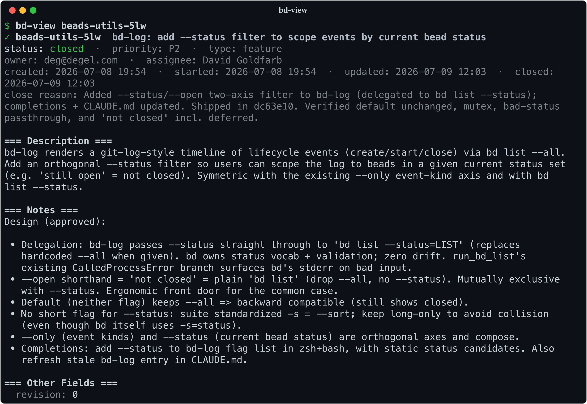
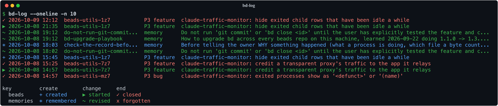
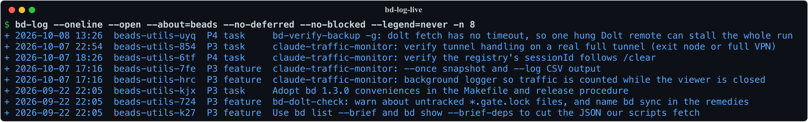
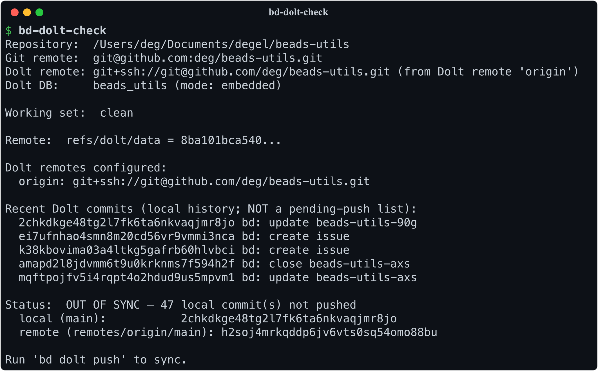
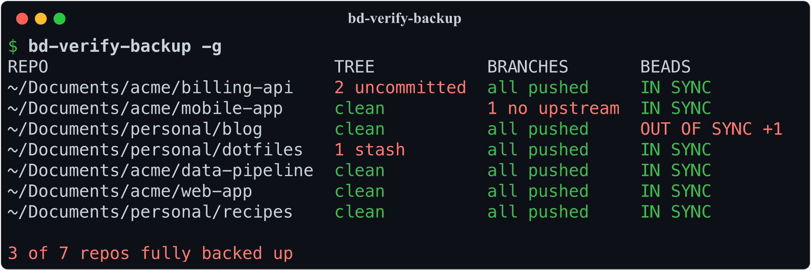

# Looking at beads

The data is already on your disk; these make it pleasant to read, and they
answer the questions agentic coding adds to an issue tracker: what did the
session just do, what did it learn, and did any of it reach the remote.

## bd-view

When an issue carries a long description — design notes, acceptance
criteria, nested lists — `bd show` prints the raw Markdown as one long
wall of text. `bd-view beads-utils-s4s` (that's an issue id) renders it
instead: real headings, real code blocks, dependencies and comments
included, paged like `git log`. Field coverage is a superset of `bd
show`'s — labels, external refs, the metadata dict, parent and children
each shown as themselves — and anything `bd` grows later lands in a
trailing `Other Fields` section rather than silently disappearing.

## bd-log

Agentic coding changes what an issue tracker has to answer. A Claude
session can create, claim, and close half a dozen beads while your
attention was on the code, and afterwards you want to know what it
actually did. `bd-log` shows the lifecycle events — created, started,
closed — newest first, git-log style. `bd-log --open` narrows to beads
still open: the to-do list the session left behind (`--no-deferred` drops
the ones parked with `bd defer`, and `--no-blocked` the ones waiting on
something else to finish), and `bd-log --id
<id> --children` narrows the other way — one bead, or one epic and
everything under it, from creation to close. `--oneline` collapses each
event to a single row when you want the shape of the week rather than
the detail of any one entry.

Beads are only half of what a session leaves behind. The other half is
what it *learned* — the memories `bd remember` accumulates, which shape
every future session and which nothing otherwise shows you the history
of. `bd remember` stores no timestamps, so `bd-log` reconstructs them
from the Dolt commits underneath and folds them into the same timeline:
`--about=memories` for that history on its own, `--about=memories
--only=end` for the ones that were dropped. Events are a small grid —
`--only` picks the verb (`create`, `change`, `end`), `--about` picks
whether it happened to a bead or to a memory — and both default to
everything, so a plain `bd-log` now answers "what happened here" for
both. This one part needs the `dolt` CLI; without it the bead half still
works exactly as before.

## bd-find-live

An end-of-session audit wants the beads that are still *live*, and status
alone can't say which those are: a group parked behind a deferred gate
bead keeps every member `open`. `bd-find-live` lists the open and
in-progress beads minus the ones whose chain of blockers reaches a
deferred bead, as the same JSON `bd list --json` gives, and names what it
left out on stderr so the exclusion is never silent. `--lean` swaps each
bead's notes log for its length, which is the listing to hand a reviewer,
and `bd-find-live | wc -c` is the size of what is open: a number worth
watching from one session to the next.

## bd-export-csv

Sometimes the right reading tool is a spreadsheet — sorting issues for a
triage meeting, or sharing the list with someone who doesn't live in a
terminal. `bd-export-csv --sort=-priority,created_at` flattens the whole
database to a CSV, presorted before the spreadsheet even opens.

## bd-dolt-check and bd-dolt-diff

These guard against a quiet failure mode. Beads keeps its data
in Dolt and pushes it to your git remote under `refs/dolt/data` — a ref
GitHub's UI never shows, so the repo page looks identical whether or not
your issues actually made it to the remote. `bd-dolt-check` answers
"did they?" — on both counts that matter, since data still sitting in
the Dolt working set is in no commit and therefore in no push. It
reports what is uncommitted and compares the rest against the remote,
exiting non-zero on either (which also makes it a CI gate). `bd-dolt-diff`
answers the follow-up — what exactly would a `bd dolt push` send? —
with an issue-level diff: added and removed beads, field-by-field
changes, dependency and comment edits.

## bd-verify-backup

`bd-verify-backup` asks the wider question: if this laptop died now, what
would be lost? Per repo it checks for uncommitted files and stashes, for
any local branch with no upstream or commits not pushed to it, and for
beads data not committed and pushed (the same check as `bd-dolt-check`).
`bd-verify-backup -g` fetches and checks every beads repo on the machine
in parallel, one line each, failures first, and exits non-zero if any of
them would lose something. Repos outside the places it scans go in
`$BD_VERIFY_EXTRA_REPOS`, colon-separated.

