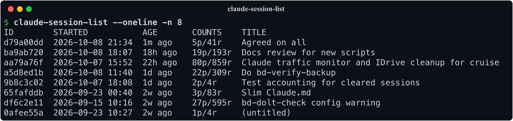
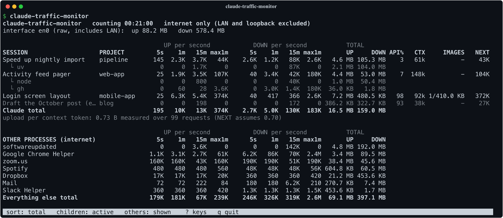

# Looking at Claude sessions

Claude Code keeps every session's transcript and every project's memory
files under `~/.claude/projects/`. These read them back: which session was
that, what did it say, what keeps going wrong across sessions, and whether
the memory store is still consistent. The last one watches sessions that
are running right now.

## claude-session-list

`claude --resume` offers a picker of recent sessions, but the picker is
cramped and can't be scripted. `claude-session-list` is the long-form
version: the sessions for the current project (or every project, with `-g`),
each with its full UUID ready to paste, a timestamp range with the
active span, prompt/reply counts, and the session title. `--oneline`
gives a compact table; `claude-session-list -q | head -1` hands a
script the newest UUID.

## claude-session-find

That covers "which session was most recent"; `claude-session-find`
covers "which session was it where we discussed the pager?" It greps
the transcripts for a substring and lists the matching sessions with
snippets for context — or, with `--oneline`, just the sessions and their
hit counts. `claude --resume $(claude-session-find -q pager | head -1)`
drops you straight back into the conversation.

## claude-session-report

And when a session turns out to be worth keeping — a design discussion,
a long debugging hunt — `claude-session-report` renders it as a
Markdown transcript: your prompts, Claude's replies, and (with `--all`)
the tool calls and every other channel too. The result is a document you can
review at leisure, commit next to the code it produced, or hand to a
colleague who asks "how did you get Claude to do that?"

## claude-session-rename

Titles are what make the picker and these scripts navigable, and
`/rename` only works from inside a running session. `claude-session-rename`
sets one from the shell — `claude-session-rename <uuid> 'Pager design'` —
so an old session can be labelled after the fact, or a batch of them from
a loop, without resuming each one. It writes exactly what `/rename` would,
and refuses a session that is currently running, where `/rename` itself is
the right tool.

## claude-sessions-review

A single session can't see that its mistake is one other sessions keep making.
`claude-sessions-review` looks across them: it reduces every failed tool call to
a signature (`zsh: no matches found`, `File has not been read yet.`,
`python: ModuleNotFoundError: ...`) and ranks the patterns by how many sessions
hit them, so one session stuck in a loop can't outrank a habit. Each pattern
shows its first and last date seen, which says whether a rule you added in
between actually stopped it, plus the values that recur (the same missing
directory, the same unquoted glob) and recent examples with the failing command. That is the raw material for a new
`CLAUDE.md` rule or memory. `--kind denied` shows what you or the auto-mode
classifier keep refusing instead, and `--json` hands all of it to a script.

## claude-memory-check

Claude Code also keeps memory files per project, cross-referenced as
`[[name]]` links and indexed by a `MEMORY.md`, and nothing checks them.
`claude-memory-check` does: a link that was meant to resolve and doesn't
(usually a hyphen where an underscore was), a slug that isn't kebab-case
or is claimed twice, and an index that disagrees with its directory are
errors; a link to a memory not written yet is listed but allowed, because
the memory format uses those as markers for what to write next. Giving
those files history is [memories.md](memories.md).

## claude-traffic-monitor

The last one watches sessions that are running right now. On a metered or slow
link, the question becomes what Claude is costing you in bytes.
`claude-traffic-monitor` is a live, `top`-like screen of each running session's
upload and download: rates over 5 s, 1 min and 15 min, totals since the monitor
started, the share that goes to the API, and the context size and images that
drive it, with an estimate of what the next message will upload. Below that
come the busiest other processes on the link, so you can tell when Claude isn't
the one using it. Press `?` for its keys. It reads macOS's `nettop`, so it runs
on macOS only.

